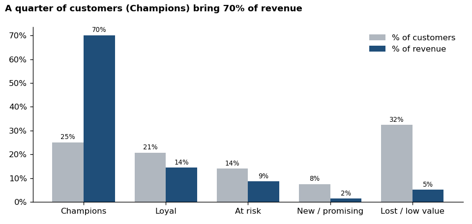
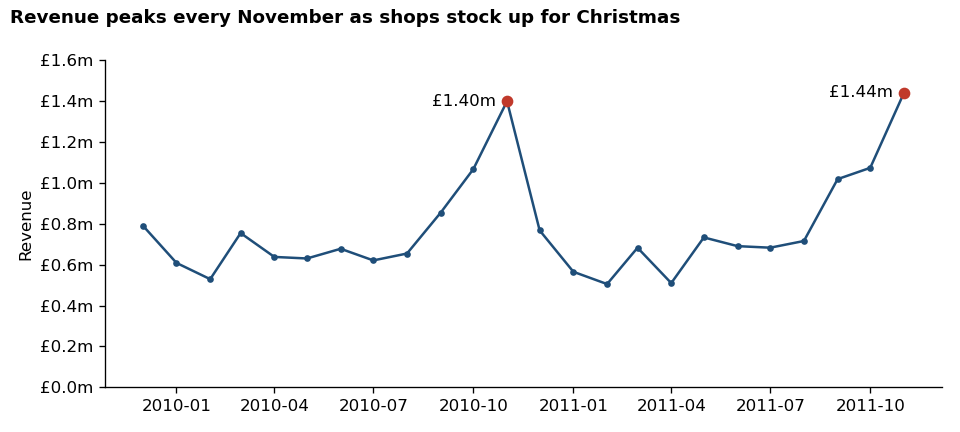

# UK Online Retail: sales trends and customer segmentation

**Result:** a quarter of this UK online gift wholesaler's customers bring 70% of its revenue, and 824 formerly frequent customers worth £1.43m have not ordered for about a year. A targeted win-back campaign is the clearest growth opportunity in a business that grew only 2.2% year on year.



## The question
When does the business make its money, which products drive it, and which customers should it focus on keeping?

## The data
- **Source:** [UCI Machine Learning Repository, Online Retail II](https://archive.ics.uci.edu/dataset/502/online+retail+ii): every transaction of a UK-based online gift wholesaler
- **Period:** 1 Dec 2009 to 9 Dec 2011
- **Size:** 1,067,371 invoice lines, reduced to 997,238 after cleaning

## What I did
1. **Cleaned the data in Python** ([`scripts/01_clean.py`](scripts/01_clean.py)). Every step and its row count is logged in [`data/cleaning_log.csv`](data/cleaning_log.csv).
   - Removed 34,335 exact duplicate lines.
   - Removed cancellations (invoices starting with `C`) **and the original orders they cancelled**. Matching each cancellation back to its order was key: without it, a mistaken order of 80,995 units of one paper craft item, cancelled minutes later, appeared as the #3 product.
   - Excluded postage, bank charges and manual adjustments, which are not products.
2. **Analysed in SQL** ([`sql/analysis_queries.sql`](sql/analysis_queries.sql), SQLite): monthly KPIs, year-on-year growth with `LAG`, product and country rankings, and an **RFM segmentation** using CTEs and `NTILE(5)`. Results are in [`sql/query_results.txt`](sql/query_results.txt).
3. **Visualised in Python** ([notebook](notebooks/uk_online_retail_analysis.ipynb)) and exported summary tables for the dashboard.
4. **Built an interactive dashboard** in Power BI (see [`dashboard/`](dashboard/)).

## Key findings
| # | Finding |
|---|---|
| 1 | **Strong seasonality:** September to November bring 36.1% of annual revenue. November peaks at £1.40m (2010) and £1.44m (2011). |
| 2 | **Flat growth:** Jan-Nov revenue grew just 2.2% from 2010 to 2011. |
| 3 | **Customer concentration:** the top 20% of customers bring 76.7% of revenue. The *Champions* segment is 25% of customers and 70% of revenue. |
| 4 | **£1.43m at risk:** 824 *At risk* customers, average spend £1,735, last ordered 369 days ago on average. |
| 5 | **Long product tail:** the top 10 of 5,331 products make up only 7.3% of revenue. |



## Recommendations
1. **Win back the 824 At risk customers** with a personalised re-engagement offer, prioritised by past spend.
2. **Protect the Champions** (1,464 customers, 70% of revenue) with account management or a loyalty scheme.
3. **Plan for the autumn peak:** stock up and launch Christmas campaigns from August.

## RFM method
| Score | Measures | Scored 1-5 with |
|---|---|---|
| **R**ecency | Days since last order (from 10 Dec 2011) | `6 - NTILE(5) OVER (ORDER BY recency_days)` |
| **F**requency | Number of distinct orders | `NTILE(5) OVER (ORDER BY frequency)` |
| **M**onetary | Total spend (£) | `NTILE(5) OVER (ORDER BY monetary)` |

Segments: **Champions** (R≥4, F≥4) · **Loyal** (R≥3, F≥3) · **New / promising** (R≥4, F≤2) · **At risk** (R≤2, F≥3) · **Lost / low value** (everyone else).

## Repository structure
| Path | Contents |
|---|---|
| `data/retail_clean.csv.gz` | Cleaned transactions (gzip CSV) |
| `data/*.csv` | Summary tables exported for the dashboard (monthly sales, products, countries, RFM) |
| `scripts/` | Cleaning and SQLite loading scripts |
| `sql/` | Analysis queries and their results |
| `notebooks/` | Jupyter notebook with charts |
| `dashboard/` | Power BI dashboard file and screenshot |

## How to reproduce
```bash
pip install pandas matplotlib openpyxl
# download online_retail_II.xlsx from the UCI link above, then:
python scripts/01_clean.py online_retail_II.xlsx
python scripts/02_load_sqlite.py
```

## Tools
Python (pandas, Matplotlib) · SQL (SQLite: CTEs, window functions) · Power BI · Jupyter

*Data: Chen, D. (2012). Online Retail II. UCI Machine Learning Repository, CC BY 4.0.*
